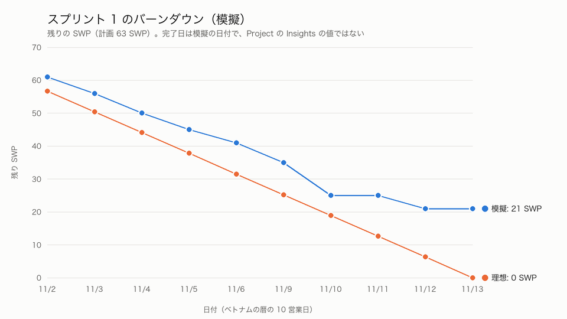

# 進捗報告 — スプリント 1「認証・基盤のスプリント」（模擬）

- Project 上のイテレーション: **スプリント 1**（GitHub Project「スプリント」欄。期間 2026-11-02〜2026-11-15、2 週間）
- 模擬した期間: 2026-11-02〜2026-11-13（ベトナムの暦で 10 営業日）。日本の暦では 11/3（文化の日）が休日のため、10 営業日目は 11/16 になる。
- このスプリントはまだ実施していない。開発の着手日を 2026-11-02 と仮定し、2 週間後の状態を Project に反映した**模擬**である。状態の更新は 1 日でまとめて行ったため、Project の Insights のグラフは実際の日付の推移を表さない。バーンダウンは、task ごとに割り当てた模擬の完了日から作った表で示す。
- このスプリントは、認証（[#16](https://github.com/binhnht-0675/Yuki-Cold-Logistics-Lab5-Backlog/issues/16) E01）と基盤（[#26](https://github.com/binhnht-0675/Yuki-Cold-Logistics-Lab5-Backlog/issues/26) E12）を中心に、各領域の顧客への確認の task を進めるスプリントである。業務の一連の流れ（入荷から出荷まで など）を届けたスプリントではない。
- 状態・エピック別・担当別・バーンダウンの表は、Project のスナップショットから自作スキル 3（github-project-progress-report）が出した表を転記した。手で数え直していない。役割ごとの稼働の表と第 3 節の見通しの数は、その表と模擬の前提から計算した。

## 1. 状態

スナップショット: 2026-10-24T21:26:17+07:00（最終レビューの反映後）。対象: イテレーション「スプリント 1」の末端の issue 31 件。集計範囲: 計画スナップショット（2026-10-24T07:12:33+07:00）でこのイテレーションに入っていた issue と、現在このイテレーションにある issue。他のイテレーションへ移動した 7 件も合計に含む。

| ステータス | issue 数 | SWP 合計 | 備考 |
|---|---|---|---|
| 未着手 | 4 | 12 |  |
| 進行中 | 2 | 6 |  |
| 完了 | 24 | 42 | クローズ済み 24 |
| ブロック中 | 1 | 3 |  |
| **合計** | 31 | 63 |  |

エピック別:

| エピック | issue 数 | 完了 | SWP 合計 | 完了 SWP | 見積時間(h) |
|---|---|---|---|---|---|
| [#16](https://github.com/binhnht-0675/Yuki-Cold-Logistics-Lab5-Backlog/issues/16)（E01） 認証・権限 | 11 | 7 | 30 | 17 | 113 |
| [#17](https://github.com/binhnht-0675/Yuki-Cold-Logistics-Lab5-Backlog/issues/17)（E02） 入荷・在庫 | 4 | 4 | 8 | 8 | 28.5 |
| [#18](https://github.com/binhnht-0675/Yuki-Cold-Logistics-Lab5-Backlog/issues/18)（E03） 受注・引当 | 1 | 1 | 1 | 1 | 2 |
| [#19](https://github.com/binhnht-0675/Yuki-Cold-Logistics-Lab5-Backlog/issues/19)（E04） 出荷（ピッキング・積込） | 1 | 1 | 1 | 1 | 2 |
| [#20](https://github.com/binhnht-0675/Yuki-Cold-Logistics-Lab5-Backlog/issues/20)（E05） 配送（ルート・運行・POD） | 2 | 2 | 3 | 3 | 4 |
| [#21](https://github.com/binhnht-0675/Yuki-Cold-Logistics-Lab5-Backlog/issues/21)（E06） 温度管理・HACCP | 1 | 1 | 1 | 1 | 2 |
| [#22](https://github.com/binhnht-0675/Yuki-Cold-Logistics-Lab5-Backlog/issues/22)（E07） トレーサビリティ・リコール | 1 | 1 | 1 | 1 | 2 |
| [#23](https://github.com/binhnht-0675/Yuki-Cold-Logistics-Lab5-Backlog/issues/23)（E08） マスターデータ・納品期限契約 | 1 | 1 | 1 | 1 | 2 |
| [#1](https://github.com/binhnht-0675/Yuki-Cold-Logistics-Lab5-Backlog/issues/1)（E09） クレーム・返品 | 1 | 1 | 1 | 1 | 2 |
| [#24](https://github.com/binhnht-0675/Yuki-Cold-Logistics-Lab5-Backlog/issues/24)（E10） レポート・監査・保持 | 2 | 2 | 2 | 2 | 4 |
| [#25](https://github.com/binhnht-0675/Yuki-Cold-Logistics-Lab5-Backlog/issues/25)（E11） 2024年運転時間規制（専用） | 2 | 2 | 4 | 4 | 9.5 |
| [#26](https://github.com/binhnht-0675/Yuki-Cold-Logistics-Lab5-Backlog/issues/26)（E12） 基盤・環境・リリース | 2 | 0 | 5 | 0 | 19 |
| [#27](https://github.com/binhnht-0675/Yuki-Cold-Logistics-Lab5-Backlog/issues/27)（E13） 外部連携 | 1 | 1 | 2 | 2 | 2 |
| [#28](https://github.com/binhnht-0675/Yuki-Cold-Logistics-Lab5-Backlog/issues/28)（E14） データ移行・切替 | 1 | 0 | 3 | 0 | 11.5 |

担当（仮）別:

| 担当（仮） | issue 数 | SWP 合計 | 見積時間(h) |
|---|---|---|---|
| BE-1 | 8 | 20 | 76 |
| BE-2 | 2 | 6 | 23 |
| BrSE | 14 | 17 | 28 |
| FE-1 | 1 | 3 | 11.5 |
| FE-2 | 2 | 6 | 23 |
| Infra-1 | 2 | 5 | 19 |
| QA-1 | 2 | 6 | 23 |

役割ごとの計画時間と、1 スプリントで使える時間（提案時の要員計画の人員（FTE）× 10 日 × 1 日 6 時間。BrSE は 0.73 人分）:

| 役割 | 計画した時間 | 使える時間 | 割合 |
|---|---|---|---|
| バックエンド（BE-1・BE-2） | 99 | 99.6 | 99 % |
| フロントエンド（FE-1・FE-2） | 34.5 | 52.8 | 65 % |
| QA（QA-1） | 23 | 49.8 | 46 % |
| インフラ（Infra-1） | 19 | 21 | 90 % |
| BrSE（顧客への確認 14 件 × 2 時間） | 28 | 43.8 | 64 % |

開発の役割（バックエンド・フロントエンド・QA・インフラ）の人員は、提案時の AI の効果（×0.8）を織り込んだ要員計画の値で、task の時間は AI 利用の前提を置いていない。前提がそろっていないため、これらの割合は高めに出ている可能性がある。

Project 全体の親 101 件は、SWP・見積時間とも子の合計と一致した。

- 計画: 31 件（開発 17 件、顧客への確認 14 件）。スプリント開始時に Project のスナップショットを撮り、スプリント 2 へ移した issue も計画の合計に含めて数えている。
- 持ち越しの 7 件（端末ログインの 4 件と、レビューで戻した 3 件）は、スプリント 2 に移し、ラベル「持ち越し」を付けた。
- 顧客への確認の task 14 件は、模擬では書面の回答を得たと仮定して完了にした。回答の内容は模擬しない。

## 2. バーンダウン（模擬）

| 日付 | 残 SWP（理想） | 残 SWP（模擬） | 当日完了 SWP |
|---|---|---|---|
| 2026-11-02 | 56.7 | 61 | 2 |
| 2026-11-03 | 50.4 | 56 | 5 |
| 2026-11-04 | 44.1 | 50 | 6 |
| 2026-11-05 | 37.8 | 45 | 5 |
| 2026-11-06 | 31.5 | 41 | 4 |
| 2026-11-09 | 25.2 | 35 | 6 |
| 2026-11-10 | 18.9 | 25 | 10 |
| 2026-11-11 | 12.6 | 25 | 0 |
| 2026-11-12 | 6.3 | 21 | 4 |
| 2026-11-13 | 0 | 21 | 0 |

完了日の出どころ: 模擬の完了日（task ごとに割り当てた日付。リポジトリには含めていない。Project の Status・クローズ状態と照合済み）。理想線は計画 63 SWP を 10 営業日で均等に減らした値。

計画との差は、次の 2 点から生じた。

- レビューで、#482・#444・#449 は依存する作業（#207・#471・#443）が未着手のまま完了としていたことが分かり、持ち越しに戻した。模擬の結果は完了 24 件・42 SWP とした。

- 11/6、端末認証の開始 API（#128）に着手したところ、先に一度終えていた端末登録の表（#131）の一意索引が、設計（有効な登録だけを対象にする条件 status = 'active'）を欠いて作られており、失効した端末を登録し直せないことが分かった。#131 の完了の定義は有効な登録の重複だけを確かめていたため見逃した。#131 を設計どおりに直した（バックエンドで約 10 時間、11/9 完了）。
- #128 は #131 に依存するため 11/9 まで進められず、その後の #128 → #130 → #127 の順の作業がスプリント内に収まらなかった。バックエンドの計画は上限に近かった（99 時間 ／ 99.6 時間）ため、手直しの分がそのまま残りの作業を押し出した。理想線との差は 11/5 の 7.2 SWP から 11/6 に 9.5 SWP へ広がり、最終日には持ち越し 7 件分の 21 SWP が残った（うち 8 SWP はレビューで戻した 3 件）。
- その結果、端末ログインの一連の作業（#128 進行中、#130 未着手、#127 画面は仮の応答で先に着手して作成中（依存の例外）、#132 結合テストはブロック中）がスプリント 2 へ持ち越しになった。レビューで戻した 3 件を除く、ほかの 24 件は予定どおり完了した。

## 3. 遅延のリスク

| リスク | issue | 影響する節目 | 対応 | 担当・時期 |
|---|---|---|---|---|
| 端末ログインの一連の作業の持ち越しで、ドライバーが端末から使い始める時期が遅れる | [#128](https://github.com/binhnht-0675/Yuki-Cold-Logistics-Lab5-Backlog/issues/128)、[#130](https://github.com/binhnht-0675/Yuki-Cold-Logistics-Lab5-Backlog/issues/130)、[#127](https://github.com/binhnht-0675/Yuki-Cold-Logistics-Lab5-Backlog/issues/127)、[#132](https://github.com/binhnht-0675/Yuki-Cold-Logistics-Lab5-Backlog/issues/132) | スプリント 2 の終わり（11/29）の端末ログインの完成 | スプリント 2 の最初に #128 → #130 を進め、#127 は仮の応答から本物の API へ切り替え、最後に #132 を通す | バックエンド担当（#128・#130）、フロントエンド担当（#127）、QA 担当（#132）／11/16〜 |
| バックエンドの計画が上限に近く、手直しが 1 件入るだけで持ち越しが出る | スプリント 2 のバックエンドの task 全体 | スプリント 2 以降の各スプリントの完了 | スプリント 2 は、バックエンドの計画を上限の 85〜90 % に抑え、手直しの余裕を残す | スプリントの計画を立てる担当（PM）／11/16 の計画時 |
| 2024 年の運転時間規制の技術的なリスク（同時公開のロック順）を、スプリント 1 から外した | [#423](https://github.com/binhnht-0675/Yuki-Cold-Logistics-Lab5-Backlog/issues/423)（[#416](https://github.com/binhnht-0675/Yuki-Cold-Logistics-Lab5-Backlog/issues/416) は完了） | ルートの公開（[#25](https://github.com/binhnht-0675/Yuki-Cold-Logistics-Lab5-Backlog/issues/25) E11）の本番化 | スプリント 2 で #423 を優先し、同時公開のテストを先に固める | バックエンド担当／スプリント 2 |
| QA の稼働が低く（約 46 %）、結合テストが連鎖の最後に集まる | [#132](https://github.com/binhnht-0675/Yuki-Cold-Logistics-Lab5-Backlog/issues/132) ほか、各画面の結合・E2E テスト | 各スプリントの完了の確認 | テスト用の仮の応答を先に用意し、API の完成前に結合テストを書き始める | QA 担当／スプリント 2 から |
| 全体の見通しが立たない: スプリント 1 で完了した 42 SWP のうち 17 SWP は顧客への確認の task で、バックログ全体の 16 件のうち 14 件をこのスプリントで終えたため、次のスプリントからはほとんど残らない。開発の task の完了は 25 SWP で、この速さが続く場合、全体に合計約 65 スプリント（スプリント 1 ＋ 残りの開発 1,600 SWP ÷ 25 の切り上げ 64）かかる。残る確認の task 3 SWP は並行して進める前提とする。これは 1 スプリントだけの値から外挿した、条件付きの見通しである。計画した開発量 46 SWP を毎回すべて完了できたとしても合計約 36 スプリント（1 ＋ 1,600 ÷ 46 の切り上げ 35）で、提案時の約 10〜11 スプリントの 3 倍を超える | バックログ全体 | 稼働の予定日（提案時の計画は約 5 か月） | スプリント 2・3 の実績で、1 SWP あたりの時間と速さを確かめ直す。そのうえで、範囲（優先度の低い機能の後回し）、体制（人数）、詰まりやすい箇所（バックエンド・結合テスト）を見直す | PM とお客様の窓口（BrSE）／スプリント 3 の終わり（12/13）までに |

- レビューで、#128・#130・#132 に端末の登録・失効（#502・#503）への依存を足した（#502・#503 は #135 に依存する）。模擬の 11/6 の時点ではこの依存がなかったため、#128 は着手した扱いのままにしている。
- スプリント 2 の計画では、持ち越しの task が依存する作業も同じスプリントに入れる。#502・#503（端末の登録・失効。スプリント 2 に割り当て済み）には #135（特権の MFA 検査）、#444・#449 には #443、#482 には #207・#471 が要る。#443 と #207 は 16 時間を超えるため、計画の前に分割する。関門（16 時間と依存）を通らない task はスプリントに入れない。
- 担当は Project の「担当（仮）」欄の役割で示した。人の名前ではない。
- 親（エピック・ストーリー）の Status は、子の完了で自動では変えない。子が完了していても、親は 未着手 のまま表示される。
- 体制（各役割の人数）は、提案時の見積の要員計画を模擬の前提として使った。実際の体制が決まったら、1 スプリントで処理できる量の計算をやり直す。
